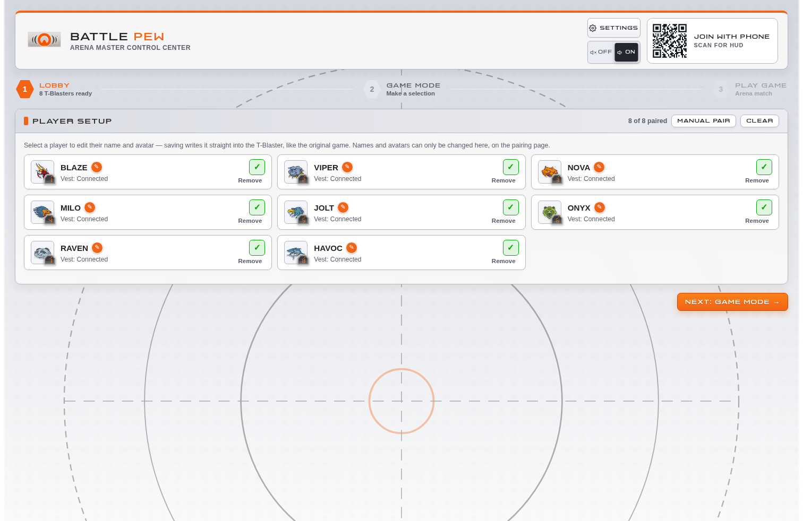
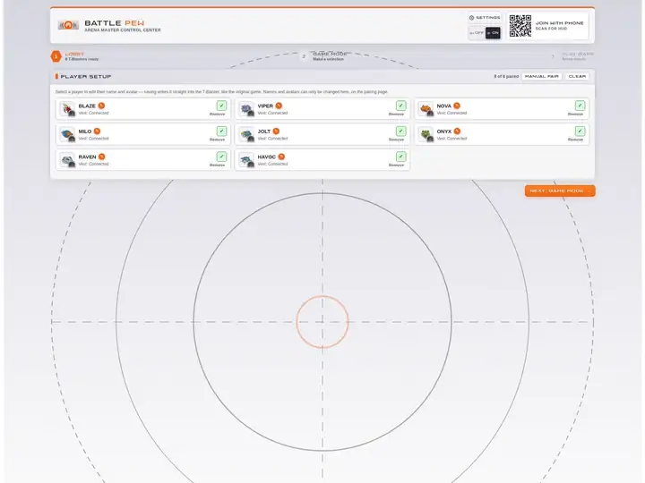
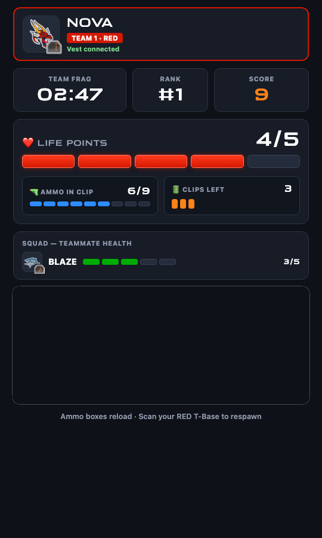

<div align="center">


# BattlePew

**A modern, cross-platform Arena Master for the Ubisoft Battle Tag (2010) laser tag system.**

[](https://github.com/macsobel/BattlePew/actions/workflows/build-macos-app.yml)
[](https://github.com/macsobel/BattlePew/actions/workflows/build-windows-linux.yml)


[Screenshots](#-screenshots) &nbsp;•&nbsp; [Download](#-download) &nbsp;•&nbsp; [Features](#-features) &nbsp;•&nbsp; [Game Modes](#-game-modes) &nbsp;•&nbsp; [Run from Source](#-run-from-source) &nbsp;•&nbsp; [Tests](#-running-tests)

</div>

For the first time, you can play Ubisoft Battle Tag on **macOS** or **Linux** (as well as Windows). BattlePew talks directly to the physical **UbiConnect** USB antenna (`0x044F:0xB365`), pairs up to 8 **T-Blasters** and **T-Vests**, flashes the original bytecode sequences over the air, tracks telemetry in real time, and serves a TV-first Arena Master display with a zero-install smartphone HUD.

> [!NOTE]
> This program was developed with the use of **Google Antigravity AI**.

> [!IMPORTANT]
> **No Ubisoft assets are included.** Announcer voices, music, sound effects, fonts and UI textures are extracted locally from your own copy of the official installer. See [Original Assets](#-original-assets-not-included).

---

## 📸 Screenshots

<table>
  <tr>
    <td align="center" width="50%">
      <br />
      <sub><b>Lobby &amp; T-Blaster Roster</b></sub>
    </td>
    <td align="center" width="50%">
      <br />
      <sub><b>Game Mode &amp; Team Selector</b></sub>
    </td>
  </tr>
  <tr>
    <td align="center" width="50%">
      <br />
      <sub><b>Live Match — Team Frag</b></sub>
    </td>
    <td align="center" width="50%">
      <br />
      <sub><b>Match Results &amp; Score Progression</b></sub>
    </td>
  </tr>
</table>

<table>
  <tr>
    <td align="center" width="62%">
      <br />
      <sub><b>Gameplay demo</b> · <a href="docs/screenshots/gameplay.mp4">full-resolution MP4</a></sub>
    </td>
    <td align="center" width="38%">
      <br />
      <sub><b>Smartphone HUD</b> — join via the on-screen QR code</sub>
    </td>
  </tr>
</table>

---

## 🔒 Original Assets Not Included

**This repository and its prebuilt releases do NOT include any of Ubisoft's copyrighted assets** (announcer voice lines, music, sound effects, fonts, or UI icons/textures).

On first launch, BattlePew checks for extracted assets in your local user data folder. If they are missing, an **Original Game Assets Required** prompt appears automatically:

1. Download the official Ubisoft Battle Tag installer from the link shown in the app:
   `http://help.support.ubi.com/BattleTag_Installer.zip`
2. Click **Select Installer...** and choose `BattleTag_Installer.zip` (or `Data1.cab`).
3. BattlePew extracts and converts the required audio, fonts, and textures into your local app data directory automatically—no restart required.

---

## 📦 Download

Grab the latest build for your platform from the [**Releases**](https://github.com/macsobel/BattlePew/releases) page, or from the artifacts of any [GitHub Actions run](https://github.com/macsobel/BattlePew/actions).

| Platform | Archive | First-launch notes |
| :-- | :-- | :-- |
| 🍎 **macOS** (Apple Silicon, 13+) | `BattlePew-macOS-*.zip` | [Gatekeeper](#macos-gatekeeper) |
| 🪟 **Windows** (x64) | `BattlePew-Windows-*.zip` | [SmartScreen](#windows-microsoft-defender-smartscreen) |
| 🐧 **Linux** (x64) | `BattlePew-Linux-*.tar.gz` | [Permissions &amp; USB access](#linux-executable-permissions--usb-hid-access) |

### Running Prebuilt Releases (Unsigned Binaries)

Prebuilt desktop releases from GitHub Actions are not code-signed with an Apple Developer ID or Microsoft Authenticode certificate, so your operating system may warn you on first launch.

#### macOS (Gatekeeper)

If macOS says **`"BattlePew" is damaged and can't be opened`** or blocks it as an unverified developer:

1. Move `BattlePew.app` to `/Applications` (or extract it to a folder).
2. Remove the quarantine attribute in Terminal:
   ```bash
   xattr -cr /Applications/BattlePew.app
   ```
   *(If you kept `BattlePew.app` in Downloads, replace the path with `~/Downloads/BattlePew.app`.)*
3. Open **BattlePew** normally.

Alternatively, try opening it once, then go to **System Settings -> Privacy & Security**, scroll to the security message for `BattlePew`, and click **Open Anyway**.

#### Windows (Microsoft Defender SmartScreen)

If Windows shows **`Windows protected your PC`**:

- **Option 1 (SmartScreen dialog):** Click **More info**, then click **Run anyway**.
- **Option 2 (Unblock before extracting):** Right-click the downloaded `BattlePew-Windows-*.zip` -> **Properties** -> check **Unblock** -> **Apply/OK**, then extract and run `BattlePew.exe`.
  Or in PowerShell:
  ```powershell
  Unblock-File -Path .\BattlePew-Windows-*.zip
  ```

#### Linux (Executable Permissions & USB HID Access)

1. Extract the archive and ensure the binary is executable:
   ```bash
   tar -xzf BattlePew-Linux-*.tar.gz
   chmod +x BattlePew/BattlePew
   ./BattlePew/BattlePew
   ```
2. **USB permissions for the UbiConnect antenna (`044F:B365`):** If your user does not have permission to open the USB HID device without `sudo`, add a udev rule:
   ```bash
   sudo tee /etc/udev/rules.d/99-ubiconnect.rules <<'EOF'
   SUBSYSTEM=="usb", ATTR{idVendor}=="044f", ATTR{idProduct}=="b365", MODE="0666"
   KERNEL=="hidraw*", ATTRS{idVendor}=="044f", ATTRS{idProduct}=="b365", MODE="0666"
   EOF
   sudo udevadm control --reload-rules && sudo udevadm trigger
   ```
   Unplug and replug the UbiConnect dongle after applying the rule.

---

## ✨ Features

| | |
| :-- | :-- |
| 🔌 **Native USB HID engine** | Bidirectional communication with the UbiConnect base station (`044F:B365`) via `hidapi`. |
| 🤝 **Persistent pairing & auto-discovery** | Finds T-Blasters in pairing mode (`Hold Reload + Power`), reads stored player names and animal avatars from EEPROM, and keeps guns paired across matches. |
| 📺 **TV-first 10-foot UI** | Lobby, live scoreboard with animated HP/ammo bars, adaptive live arena feed, and a results podium with score progression. |
| 📱 **Phone HUD** | Scan the on-screen QR code for a personalised, zero-install HUD with real-time ammo, health, clips and match timer. |
| 🧪 **Simulator mode** | Built-in simulator with a Bot Arena and manual trigger deck — test without any hardware. |
| 🔊 **Original audio & visuals** | Voice lines, mode intros, sound effects, music and icons play once extracted from *your* copy of `BattleTag_Installer.zip`. |

### 🎮 Game Modes

| Mode | Description |
| :-- | :-- |
| **Free Frag** | Instant action, infinite life & ammo — every hit scores +1 point. |
| **Team Frag** | 2–4 squads (Red, Blue, Yellow, Green), Life Points, and T-Base respawn. |
| **Free For All** | 2–8 players, solo combat with Life Points, clips, and T-Base respawn. |
| **Last Man Standing** | High-stakes survival elimination — no respawns. |
| **Wild West Duel** | 2-player quickdraw showdown across 5 tense rounds. |
| **Starter Frag** | Infinite life with physical RFID Ammo Card reloads. |
| **Tag'n Shoot** | Solo agility sprint — scan T-Bases, then shoot the UbiConnect tower. |

---

## 🧰 Requirements (Running from Source)

- **macOS**, **Windows**, or **Linux**
- **Python** 3.10 to 3.13
- **UbiConnect USB Antenna** (`0x044F:0xB365`) & **Ubisoft Battle Tag T-Blasters** (optional for simulator mode)

---

## 🚀 Run from Source

### 1. Clone & Set Up Virtual Environment

```bash
git clone https://github.com/macsobel/BattlePew.git
cd BattlePew

python3 -m venv .venv
source .venv/bin/activate   # On Windows PowerShell: .venv\Scripts\Activate.ps1
pip install -r requirements.txt
```

### 2. Run the Server

#### Live Hardware Mode (Plug in UbiConnect USB):
```bash
python run_battletag.py --port 3466 --confirm-write
```

#### Simulator Mode (No hardware required):
```bash
python run_battletag.py --port 3466
```

### 3. Open the Arena Master

Open your browser to:
```
http://localhost:3466
```

- Connect your TV or projector for the 10-foot spectator display.
- Players can scan the QR code to open their personal HUD at `http://<your-lan-ip>:3466/hud`.

---

## ✅ Running Tests

Automated tests verify packet framing, `0x95` status decoding, `0x92` configuration packets, and game engine scoring:

```bash
pytest -v
```

---

## 📄 License

MIT License — see [LICENSE](LICENSE). Ubisoft Battle Tag assets and audio are property of Ubisoft Entertainment and are not distributed with this repository.

---

<div align="center">
  <sub>BattlePew is an independent fan project and is not affiliated with or endorsed by Ubisoft Entertainment.</sub>
</div>
