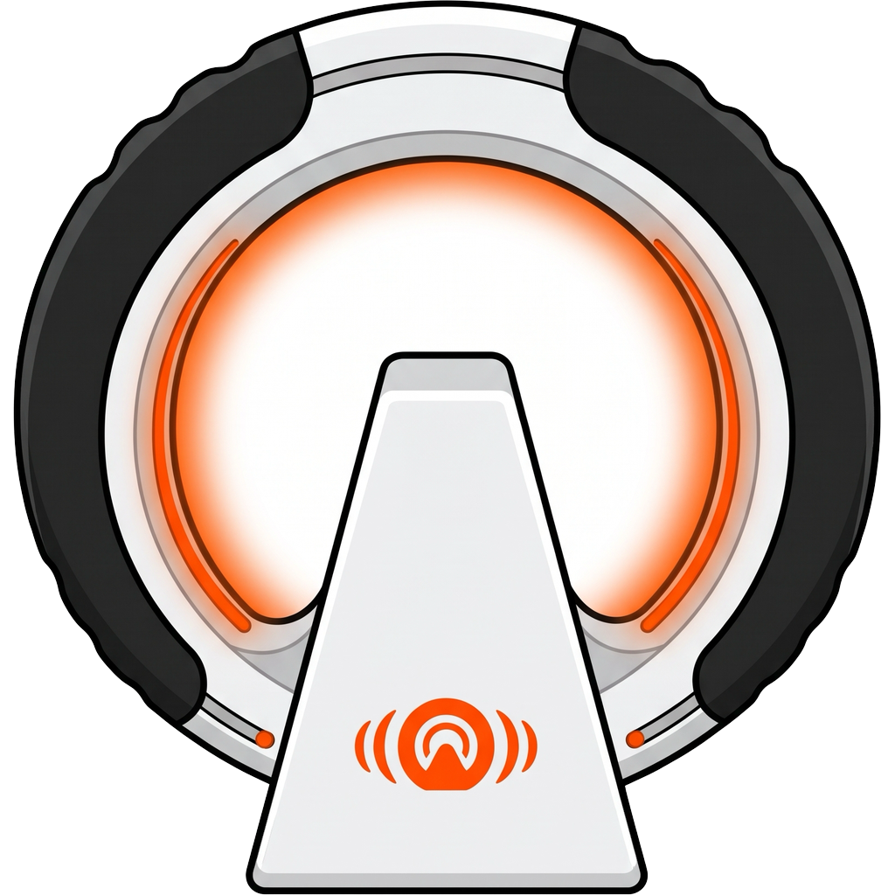
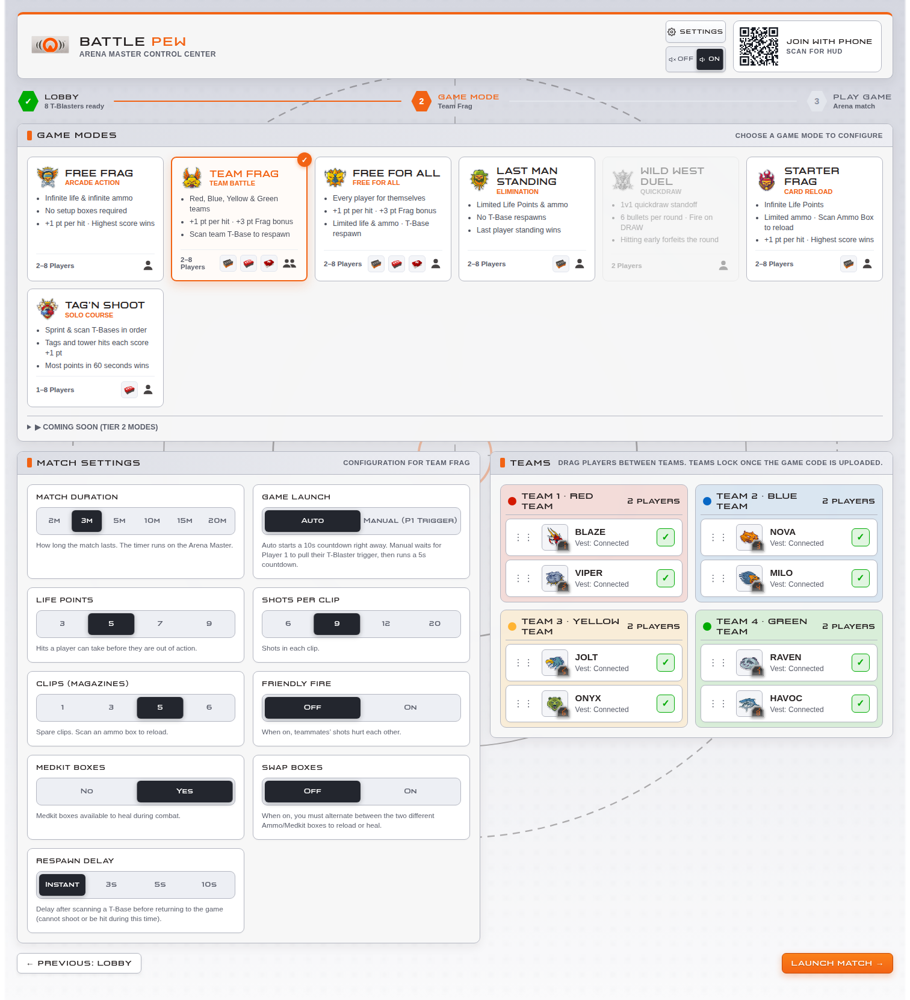
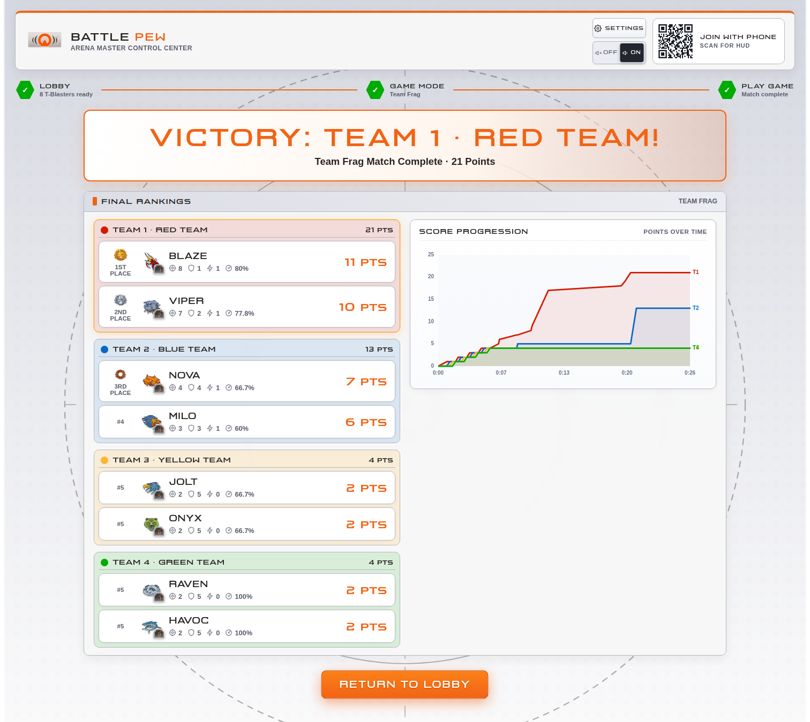

<div align="center">



# BattlePew

**Play Ubisoft Battle Tag (2010) laser tag on your Mac, Windows or Linux computer.**

[](https://github.com/macsobel/BattlePew/actions/workflows/build-macos-app.yml)
[](https://github.com/macsobel/BattlePew/actions/workflows/build-windows-linux.yml)


[Screenshots](#-screenshots) &nbsp;•&nbsp; [Download](#-download) &nbsp;•&nbsp; [What you can do](#-what-you-can-do) &nbsp;•&nbsp; [Game modes](#-game-modes) &nbsp;•&nbsp; [For developers](#for-developers)

</div>

**For the first time, you can play Ubisoft Battle Tag on a Mac or a Linux PC** — as well as Windows.

BattlePew is a free replacement for the original Battle Tag game software. Plug in your Battle Tag USB base station (the **UbiConnect**), turn on your **T-Blasters**, and BattlePew takes care of the rest: it connects your blasters, sets up the game, keeps score, and shows a big live scoreboard you can put up on a TV. Players can also follow their own ammo, health and score on their phone — just scan a QR code, no app to install.

> [!NOTE]
> This program was developed with the use of **Google Antigravity AI**.

> [!IMPORTANT]
> **No Ubisoft game files are included.** The announcer voices, music, sound effects and artwork come from your own copy of the official Battle Tag installer, which BattlePew unpacks for you the first time you run it. See [Game files](#-game-files-not-included).

---

## 📸 Screenshots

<table>
  <tr>
    <td align="center" width="50%">
      <br />
      <sub><b>Lobby — see who has joined</b></sub>
    </td>
    <td align="center" width="50%">
      <br />
      <sub><b>Pick a game mode and teams</b></sub>
    </td>
  </tr>
  <tr>
    <td align="center" width="50%">
      <br />
      <sub><b>Live scoreboard — Team Frag</b></sub>
    </td>
    <td align="center" width="50%">
      <br />
      <sub><b>Results and score over time</b></sub>
    </td>
  </tr>
</table>

<table>
  <tr>
    <td align="center" width="62%">
      <br />
      <sub><b>See it in action</b> · <a href="docs/screenshots/gameplay.mp4">full-resolution MP4</a></sub>
    </td>
    <td align="center" width="38%">
      <br />
      <sub><b>Phone screen</b> — join by scanning the QR code</sub>
    </td>
  </tr>
</table>

---

## 🔒 Game files not included

BattlePew does **not** ship any of Ubisoft's copyrighted material (announcer voices, music, sound effects, fonts or artwork). Instead, it borrows them from your own copy of the game. The first time you open BattlePew, a **"Original Game Assets Required"** window walks you through it:

1. Download the official Battle Tag installer from Ubisoft: <http://help.support.ubi.com/BattleTag_Installer.zip>
2. In BattlePew, click **Select Installer…** and choose the file you just downloaded (`BattleTag_Installer.zip`, or `Data1.cab` if you've unpacked it).
3. BattlePew unpacks everything it needs and you're ready to play — no restart required.

---

## 📦 Download

Get the latest version for your computer from the [**Releases**](https://github.com/macsobel/BattlePew/releases) page (or from any [GitHub Actions run](https://github.com/macsobel/BattlePew/actions)).

| Your computer | Download | Need help opening it? |
| :-- | :-- | :-- |
| 🍎 **Mac** (Apple Silicon, macOS 13 or newer) | `BattlePew-macOS-*.zip` | [Mac tips](#-mac) |
| 🪟 **Windows** (64-bit) | `BattlePew-Windows-*.zip` | [Windows tips](#-windows) |
| 🐧 **Linux** (64-bit) | `BattlePew-Linux-*.tar.gz` | [Linux tips](#-linux) |

### First time opening BattlePew

BattlePew isn't signed with a paid Apple or Microsoft developer certificate, so your computer may show a warning the first time you open it. That's expected — here's how to get past it.

#### 🍎 Mac

If macOS says **"BattlePew is damaged and can't be opened"** or blocks it from an unidentified developer:

1. Move `BattlePew.app` into your **Applications** folder.
2. Open the **Terminal** app and paste this line, then press Return:
   ```bash
   xattr -cr /Applications/BattlePew.app
   ```
3. Open BattlePew as normal.

Prefer not to use Terminal? Try opening BattlePew once, then go to **System Settings → Privacy & Security**, scroll down to the message about BattlePew, and click **Open Anyway**.

#### 🪟 Windows

If you see **"Windows protected your PC"**, click **More info**, then **Run anyway**.

You can also avoid the warning by right-clicking the downloaded `.zip`, choosing **Properties**, ticking **Unblock**, and clicking **OK** *before* you extract it. Then open `BattlePew.exe`.

#### 🐧 Linux

1. Extract the download and start the app:
   ```bash
   tar -xzf BattlePew-Linux-*.tar.gz
   chmod +x BattlePew/BattlePew
   ./BattlePew/BattlePew
   ```
2. If BattlePew can't see your USB base station, your account probably needs permission to use it. Run this once, then unplug and re-plug the base station:
   ```bash
   sudo tee /etc/udev/rules.d/99-ubiconnect.rules <<'EOF'
   SUBSYSTEM=="usb", ATTR{idVendor}=="044f", ATTR{idProduct}=="b365", MODE="0666"
   KERNEL=="hidraw*", ATTRS{idVendor}=="044f", ATTRS{idProduct}=="b365", MODE="0666"
   EOF
   sudo udevadm control --reload-rules && sudo udevadm trigger
   ```

---

## ✨ What you can do

| | |
| :-- | :-- |
| 🔌 **Plug in and play** | Connects straight to the original Battle Tag USB base station — no extra drivers or adapters. |
| 🤝 **Easy pairing** | Turn on your T-Blasters (hold **Reload + Power** to pair) and they show up in the lobby with their saved names and animal avatars. They stay paired from one game to the next. |
| 📺 **Made for the big screen** | A large, easy-to-read scoreboard with live health and ammo bars, a running feed of the action, and a podium and score graph when the match ends. |
| 📱 **Follow along on your phone** | Scan the QR code on screen to see your own ammo, health, clips and match timer. Nothing to install. |
| 🧪 **Try it without any gear** | A built-in practice mode with computer-controlled players lets you test everything without a base station or blasters. |
| 🔊 **The original sound and look** | Announcer voices, music, sound effects and artwork from the original game, using your own copy of the files. |

### 🎮 Game modes

| Mode | What it is |
| :-- | :-- |
| **Free Frag** | Pure, fast action. Unlimited health and ammo — every hit scores a point. |
| **Team Frag** | Two to four teams (Red, Blue, Yellow, Green) with health points and respawns at your team's base. |
| **Free For All** | Two to eight players, every player for themselves, with health, ammo clips and base respawns. |
| **Last Man Standing** | Survival mode. Once you're out, you're out — last player standing wins. |
| **Wild West Duel** | A two-player quick-draw showdown over five tense rounds. |
| **Starter Frag** | Unlimited health, but you reload by scanning an RFID ammo card. |
| **Tag'n Shoot** | A solo race: scan the base stations, then shoot the UbiConnect tower. |

---

## 🧰 What you'll need

- A **Mac, Windows PC or Linux PC**
- The **Battle Tag USB base station (UbiConnect)** and **T-Blasters** — or nothing at all if you just want to try the practice mode
- A copy of the **official Battle Tag installer** from Ubisoft (see [Game files](#-game-files-not-included))
- Optional: a **TV or projector** for the big scoreboard, and **phones** for the player screens

---

## For developers

Everything below is for people who want to run BattlePew from its source code, or build their own software for Battle Tag hardware.

### 📚 Build your own Battle Tag software

Want to write your own game software, or just understand how the hardware works? The full write-up on how the UbiConnect, T-Blasters and T-Vests talk to each other — the USB connection, pairing, uploading game code, the match loop, game-mode behavior, audio, and the questions still open — is in **[`docs/reverse-engineering/`](docs/reverse-engineering/README.md)**. Start with the [overview](docs/reverse-engineering/01-overview-and-method.md) or the [glossary](docs/reverse-engineering/glossary.md).

### Requirements

- Python 3.10 – 3.13 on macOS, Windows or Linux
- A UbiConnect base station and T-Blasters (optional — simulator mode needs no hardware)

### Run from source

```bash
git clone https://github.com/macsobel/BattlePew.git
cd BattlePew

python3 -m venv .venv
source .venv/bin/activate   # On Windows PowerShell: .venv\Scripts\Activate.ps1
pip install -r requirements.txt
```

**With real hardware** (plug in the UbiConnect first):

```bash
python run_battletag.py --port 3466 --confirm-write
```

**Simulator mode** (no hardware required):

```bash
python run_battletag.py --port 3466
```

Then open <http://localhost:3466> in your browser. Connect a TV or projector for the big scoreboard; players can scan the on-screen QR code to open their own screen at `http://<your-lan-ip>:3466/hud`.

### Run the tests

```bash
pytest -v
```

The tests cover packet framing, status decoding, configuration packets and game scoring.

---

## 📄 License

MIT License — see [LICENSE](LICENSE). Ubisoft Battle Tag assets and audio are property of Ubisoft Entertainment and are not distributed with this repository.

---

<div align="center">
  <sub>BattlePew is an independent fan project and is not affiliated with or endorsed by Ubisoft Entertainment.</sub>
</div>
