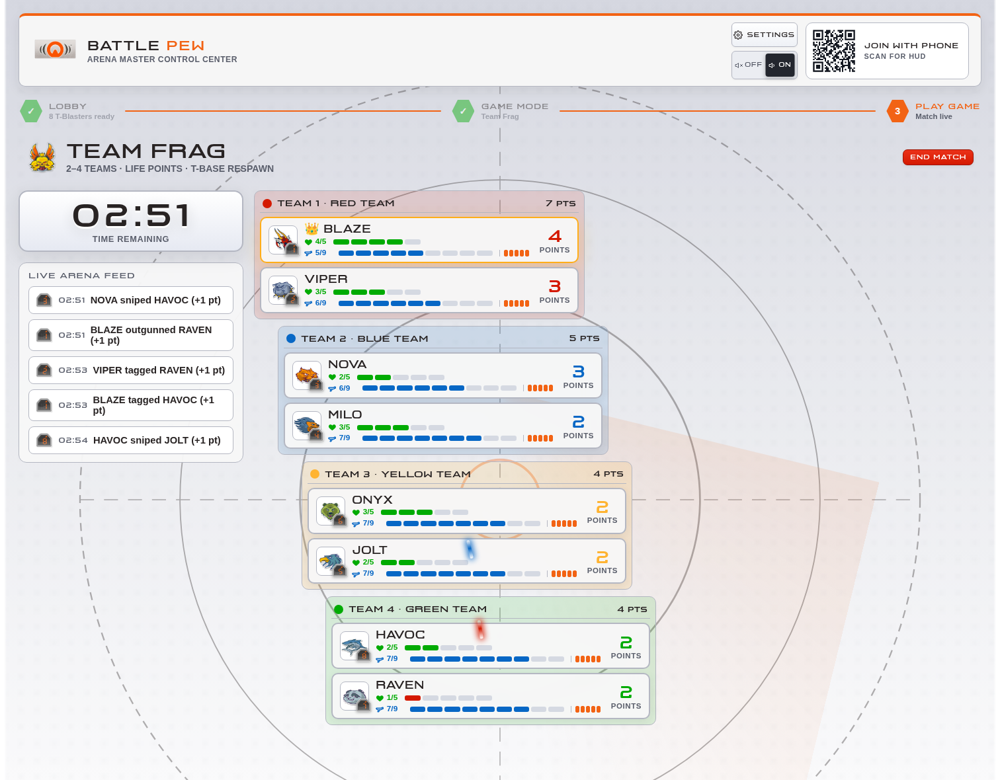

# BattlePew

A modern cross-platform Arena Master and replacement server for the **Ubisoft Battle Tag (2010)** laser tag system, supporting **macOS**, **Windows**, and **Linux**.

Directly communicates with the physical **UbiConnect** USB antenna/tower (`0x044F:0xB365`), pairs up to 8 **T-Blasters** and **T-Vests**, flashes original Ubisoft bytecode sequences over the air, tracks telemetry in real-time, and hosts a TV-first responsive Arena Master HUD with smartphone integration.

> **Disclaimer:** This program was developed with the use of **Google Antigravity AI**.

---

## Screenshots

<table>
  <tr>
    <td align="center" width="50%">
      <strong>Lobby &amp; T-Blaster Roster</strong><br />
      
    </td>
    <td align="center" width="50%">
      <strong>Game Mode &amp; Team Selector</strong><br />
      
    </td>
  </tr>
  <tr>
    <td align="center" width="50%">
      <strong>Live Match — Team Frag</strong><br />
      
    </td>
    <td align="center" width="50%">
      <strong>Match Results &amp; Score Progression</strong><br />
      
    </td>
  </tr>
</table>

<div align="center">
  <strong>Smartphone Player HUD</strong> (join via on-screen QR code)<br /><br />
  
</div>

<div align="center">
  <br />
  <strong>Gameplay Demo</strong><br /><br />
  <video src="docs/screenshots/gameplay.mp4" controls width="720"></video><br />
  <a href="docs/screenshots/gameplay.mp4">Watch Gameplay Demo (MP4)</a>
</div>

---

## Important: Original Assets Not Included

**This repository and its prebuilt releases do NOT include any of Ubisoft's copyrighted assets** (announcer voice lines, music, sound effects, fonts, or UI icons/textures).

On first launch, BattlePew checks for extracted assets in your local user data folder. If they are missing, an **Original Game Assets Required** prompt appears automatically:

1. Download the official Ubisoft Battle Tag installer from the link shown in the app:
   `http://help.support.ubi.com/BattleTag_Installer.zip`
2. Click **Select Installer...** and choose `BattleTag_Installer.zip` (or `Data1.cab`).
3. BattlePew extracts and converts the required audio, fonts, and textures into your local app data directory automatically—no restart required.

---

## Running Prebuilt Releases (Unsigned Binaries)

Prebuilt desktop releases from GitHub Actions are not code-signed with an Apple Developer ID or Microsoft Authenticode certificate, so your operating system may warn you on first launch.

### macOS (Gatekeeper)

If macOS says **`"BattlePew" is damaged and can't be opened`** or blocks it as an unverified developer:

1. Move `BattlePew.app` to `/Applications` (or extract it to a folder).
2. Remove the quarantine attribute in Terminal:
   ```bash
   xattr -cr /Applications/BattlePew.app
   ```
   *(If you kept `BattlePew.app` in Downloads, replace the path with `~/Downloads/BattlePew.app`.)*
3. Open **BattlePew** normally.

Alternatively, try opening it once, then go to **System Settings -> Privacy & Security**, scroll to the security message for `BattlePew`, and click **Open Anyway**.

### Windows (Microsoft Defender SmartScreen)

If Windows shows **`Windows protected your PC`**:

- **Option 1 (SmartScreen dialog):** Click **More info**, then click **Run anyway**.
- **Option 2 (Unblock before extracting):** Right-click the downloaded `BattlePew-Windows-*.zip` -> **Properties** -> check **Unblock** -> **Apply/OK**, then extract and run `BattlePew.exe`.
  Or in PowerShell:
  ```powershell
  Unblock-File -Path .\BattlePew-Windows-*.zip
  ```

### Linux (Executable Permissions & USB HID Access)

1. Extract the archive and ensure the binary is executable:
   ```bash
   tar -xzf BattlePew-Linux-*.tar.gz
   chmod +x BattlePew/BattlePew
   ./BattlePew/BattlePew
   ```
2. **USB permissions for the UbiConnect antenna (`044F:B365`):** If your user does not have permission to open the USB HID device without `sudo`, add a udev rule:
   ```bash
   sudo tee /etc/udev/rules.d/99-ubiconnect.rules <<'EOF'
   SUBSYSTEM=="usb", ATTR{idVendor}=="044f", ATTR{idProduct}=="b365", MODE="0666"
   KERNEL=="hidraw*", ATTRS{idVendor}=="044f", ATTRS{idProduct}=="b365", MODE="0666"
   EOF
   sudo udevadm control --reload-rules && sudo udevadm trigger
   ```
   Unplug and replug the UbiConnect dongle after applying the rule.

---

## Features

- **Hardware USB HID Engine**: Native, bidirectional communication with the UbiConnect base station (`044F:B365`) using `hidapi`.
- **Persistent Pairing & Auto-Discovery**: Automatically discovers and pairs T-Blasters in pairing mode (`Hold Reload + Power`), reads stored profiles from EEPROM (player names & animal avatars), and keeps guns paired across matches.
- **7 Fully-Functional Tier 1 Game Modes**:
  - **Free Frag**: Instant action, infinite life & ammo — every hit scores +1 point.
  - **Team Frag**: 2–4 squads (Red, Blue, Yellow, Green), Life Points, and T-Base respawn.
  - **Free For All**: 2–8 players, solo combat with Life Points, clips, and T-Base respawn.
  - **Last Man Standing**: High-stakes survival elimination — no respawns.
  - **Wild West Duel**: 2-player quickdraw showdown across 5 tense rounds.
  - **Starter Frag**: Infinite life with physical RFID Ammo Card reloads.
  - **Tag'n Shoot**: Solo agility sprint — scan T-Bases then shoot the UbiConnect tower.
- **TV-First 10-Foot Arena Master UI**:
  - **Lobby Screen**: Mode cards, match settings, paired gun roster, manual pair controls, and pre-match bytecode upload verification.
  - **Live Match View**: Giant monospace clock (`clamp()` scaling), high-contrast team/player scoreboard cards with animated HP/ammo bars, and real-time kill-feed.
  - **Results Screen**: Winner announcements, final rankings podium, and rematch actions.
  - **Simulator / Debug Screen**: Built-in simulator with Bot Arena and manual trigger deck for testing without physical hardware.
- **Phone HUD (QR Code Join)**: Any player can scan the on-screen QR code with their smartphone to open a personalized, zero-install mobile HUD showing their real-time ammo, health, clips, and match timer.
- **Original Audio & Visuals (User-Imported)**: Plays original Ubisoft voice lines, mode introductions, sound effects, music tracks, and icons once extracted from your copy of `BattleTag_Installer.zip`.

---

## Requirements (Running from Source)

- **macOS**, **Windows**, or **Linux**
- **Python** 3.10 to 3.13
- **UbiConnect USB Antenna** (`0x044F:0xB365`) & **Ubisoft Battle Tag T-Blasters** (optional for simulator mode)

---

## Quickstart (From Source)

### 1. Clone & Set Up Virtual Environment

```bash
git clone https://github.com/macsobel/BattlePew.git
cd BattlePew

python3 -m venv .venv
source .venv/bin/activate   # On Windows PowerShell: .venv\Scripts\Activate.ps1
pip install -r requirements.txt
```

### 2. Run the Server

#### Live Hardware Mode (Plug in UbiConnect USB):
```bash
python run_battletag.py --port 3466 --confirm-write
```

#### Simulator Mode (No hardware required):
```bash
python run_battletag.py --port 3466
```

### 3. Open the Arena Master

Open your browser to:
```
http://localhost:3466
```

- Connect your TV or projector for the 10-foot spectator display.
- Players can scan the QR code to open their personal HUD at `http://<your-lan-ip>:3466/hud`.

---

## Running Tests

Automated tests verify packet framing, `0x95` status decoding, `0x92` configuration packets, and game engine scoring:

```bash
pytest -v
```

---

## License

MIT License. Ubisoft Battle Tag assets and audio are property of Ubisoft Entertainment and are not distributed with this repository.
